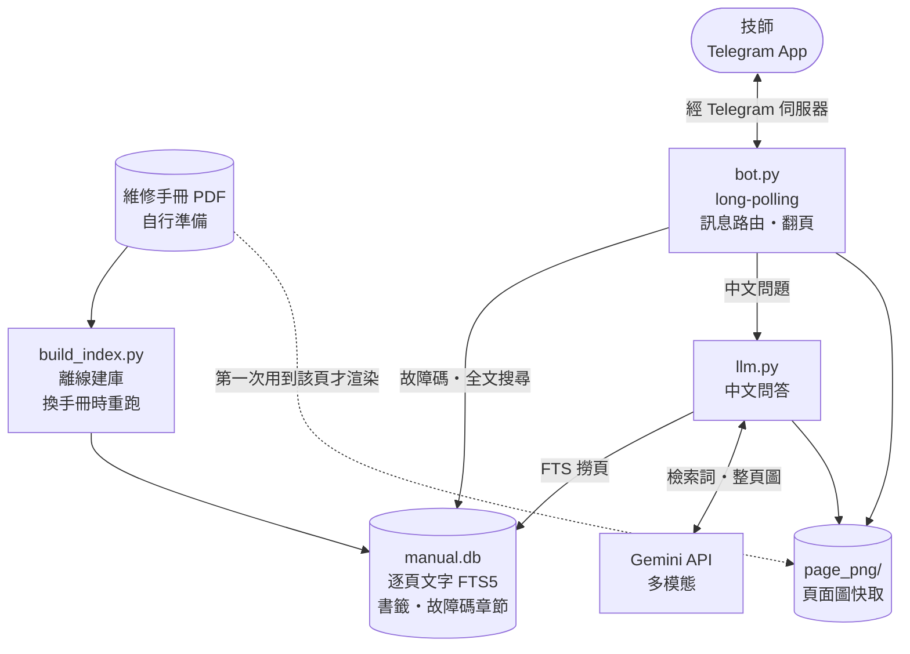
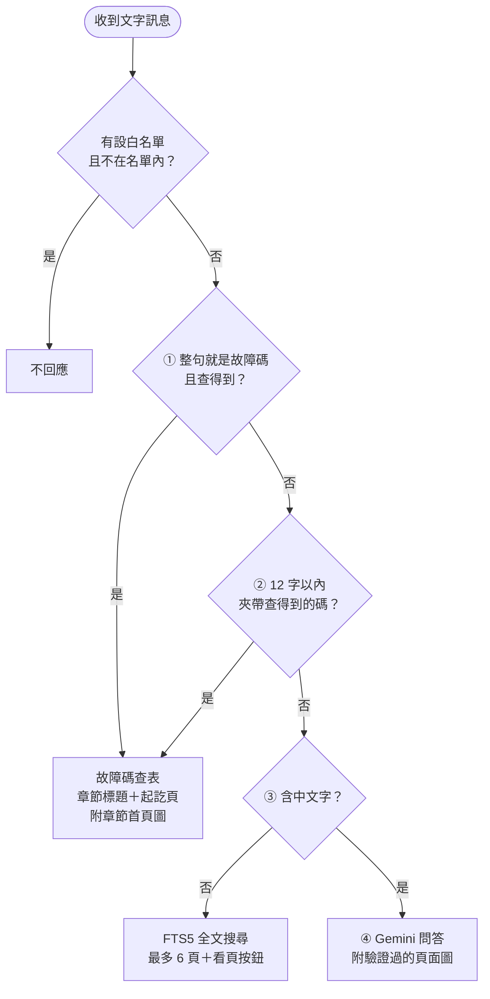
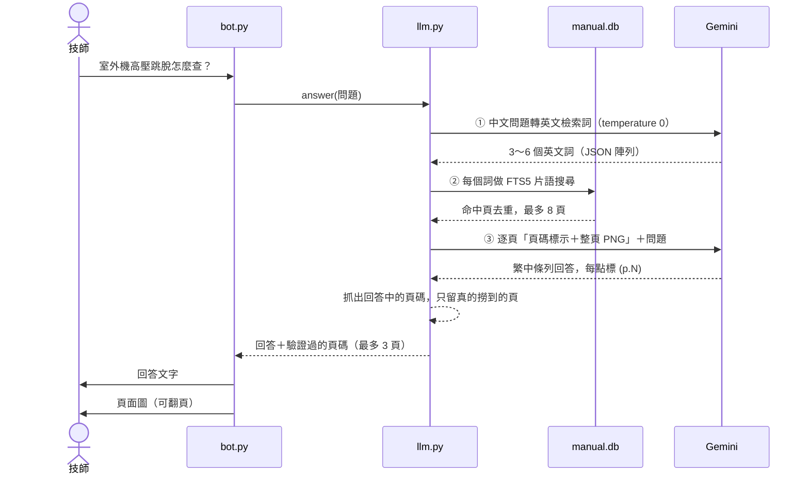

# 維修手冊 Telegram 查詢 Bot

維修技師在 Telegram 輸入「故障碼／英文關鍵字／中文問題」，就能即時查設備維修手冊。每個回覆都標出 PDF 頁碼，也能直接看原版頁面圖、上下翻頁。
範例針對大金（Daikin）VRV（REYQ12-60BYLT 系列）的英文維修手冊。這類手冊圖表多，技師要找的往往就是「某一頁」。

> 架構：Python long-polling bot（不需對外開 port）＋SQLite FTS5 逐頁索引＋Gemini 多模態問答。
> **本 repo 不含任何手冊內容**：手冊 PDF、建好的 `manual.db`、頁面圖都屬原廠版權，請自行準備手冊 PDF 建庫。

---

## 目錄

1. [設計核心](#設計核心)
2. [整體架構](#整體架構)
3. [訊息路由與指令](#訊息路由與指令)
4. [AI 問答與三道保險](#ai-問答與三道保險)
5. [檔案說明](#檔案說明)
6. [手冊索引怎麼建](#手冊索引怎麼建)
7. [設定與權限](#設定與權限)
8. [安裝與部署](#安裝與部署)
9. [日常維運](#日常維運)
10. [套用到其他手冊](#套用到其他手冊)
11. [已知的坑](#已知的坑)

---

## 設計核心

- **知識放檢索層，不放模型權重**：手冊不做人工整理，模型也不做微調。PDF 跑一次建庫腳本就能上線；手冊改版時重跑建庫即可。
- **能查表就不動用 AI**：訊息依「由嚴到寬」四關分流。故障碼與英文關鍵字走確定性查詢（最準、最快，也不花 token），只有中文問題才進 LLM，並加上三道防幻覺保險。
- **圖表交給原頁呈現**：以「頁」為切分單位，因為維修手冊的表格、接線圖、排障流程本來就以頁為界。查詢結果附整頁圖。AI 問答走**多模態**，直接把手冊頁的「圖片」交給模型判讀表格與圖面，不讓模型讀攤平後的文字去猜欄位。

---

## 整體架構



- `bot.py` 用 long-polling 主動向 Telegram 拉訊息。因為只有對外連線，不必在防火牆開洞，也不需要 HTTPS 憑證。
- **執行期也會讀 PDF**：某一頁第一次被查看時，才從 PDF 渲染成圖並存進 `page_png/`（`bot.py` 與 `llm.py` 共用這份快取）。所以 bot 執行期間 `pdf_path` 必須一直讀得到，不是只有建庫時要用。
- 問答時只會把撈到的那幾頁送給 Gemini，不會上傳整本手冊。

---

## 訊息路由與指令



| 輸入範例 | 走哪一關 | 回覆 |
|---|---|---|
| `E3`、`U4`、`A3-01` | ① 整句就是故障碼 | 對應排障章節的標題與起訖頁，附章節第一頁的頁面圖。一碼對多個章節時，每個章節各發一張。子碼查不到時自動退回主碼（`A3-01` → `A3`） |
| `E3 是什麼`、`E3？` | ② 12 字以內、夾帶查得到的碼 | 同上，不動用 AI（碼要跟中文隔開，見[已知的坑](#已知的坑)） |
| `drain pump` | ③ 不含中文 | FTS5 全文搜尋，列出最多 6 個命中頁（命中字以 `[ ]` 標出），每頁一顆「看 p.N」按鈕 |
| `室外機高壓跳脫怎麼查？` | ④ 含中文 | Gemini 多模態問答，附驗證過的頁面圖 |
| 頁面圖下方按鈕 | — | ⬅ 上一頁／下一頁 ➡，直接翻頁 |

指令（強制指定查詢方式）：

| 指令 | 作用 |
|---|---|
| `/start`、`/help` | 使用說明 |
| `/code E3` | 強制故障碼查詢 |
| `/find high pressure` | 強制全文搜尋 |
| `/ask 問題` | 強制 AI 問答 |
| `/page 301` | 看指定的 PDF 頁 |
| `/id` | 顯示自己的 Telegram ID（不受白名單限制，方便還沒加入名單的人取得 ID） |

> 頁碼一律是 **PDF 頁碼**（從第 1 頁起算），不是手冊上印的頁碼。兩者通常差了封面、目錄等前置頁的頁數。

---

## AI 問答與三道保險



1. **先翻譯、不搶答**：LLM 第一步只負責把中文問題轉成英文檢索詞，找頁的工作交給全文索引，結果可解釋、可重現。
2. **只准看撈到的頁**：系統提示要求模型只能根據提供的手冊頁回答，每個論點都要標 `(p.N)`。查不到就直接說，並建議技師可以試的關鍵字或故障碼。
3. **頁碼逐一驗證**：程式從回答中抓出所有 `p.N`，只保留確實有撈到的頁，去重後最多附 3 張頁面圖。⚠ 這道驗證只決定**附哪幾張圖**；回答文字照模型原文送出，不會被改寫。

退路：

| 狀況 | 行為 |
|---|---|
| 沒填 `gemini_api_key` | 回覆「無法使用智慧問答」，並建議改打故障碼或英文關鍵字；其他功能照常 |
| 檢索詞撈不到任何頁 | 回覆這次用了哪些關鍵字，請技師換個說法 |
| `llm_use_page_images: false` | 改送每頁文字（截前 3,500 字），不送圖 |
| 某一頁渲染失敗 | 只有該頁退回文字，回答不中斷 |
| 回答超過 4,000 字 | 截斷後送出（Telegram 單則上限 4,096 字） |

---

## 檔案說明

| 檔案 | 用途 | 怎麼跑 |
|---|---|---|
| `build_index.py` | 讀手冊 PDF，產生 `manual.db`（**會先刪掉舊檔再整個重建**） | `python build_index.py` |
| `bot.py` | Telegram bot 主程式：訊息路由、指令、翻頁按鈕、頁面圖渲染與重試 | `python -X utf8 bot.py`，或掛成 NSSM 服務 |
| `llm.py` | Gemini 問答模組：檢索詞 → FTS 撈頁 → 多模態回答 → 頁碼驗證 | 由 `bot.py` import |
| `peek_db.py` | 快速檢視 `manual.db`：各表筆數、前兩頁文字、章節與故障碼對照範例 | `python peek_db.py` |
| `config.example.json` | `config.json` 的範本 | 複製後填值 |
| `requirements.txt` | `pymupdf`、`python-telegram-bot>=21`、`google-genai` | `pip install -r requirements.txt` |

不在 repo 的東西（見 `.gitignore`）：`config.json`（token、API key、本機路徑）、`*.pdf`、`manual.db`、`page_png/`（手冊內容，屬原廠版權）、`*.log`、`__pycache__/`。

---

## 手冊索引怎麼建

`build_index.py` 用 PyMuPDF 讀 PDF，產生下列資料表：

| 資料表 | 內容 | 來源 |
|---|---|---|
| `pages` | 每頁一列：`pdf_page`、`part`（所屬的第一層書籤標題）、`text` | 逐頁抽出的文字 |
| `pages_fts` | FTS5 全文索引（內容指向 `pages`） | 同上 |
| `toc` | PDF 書籤：層級、標題、頁碼 | PDF 內建書籤 |
| `sections` | 排障章節：編號（如 `4.40`）、標題、起訖頁 | Part 6 每頁上方的章節標題 |
| `section_codes` | 故障碼 → 章節（一碼可以對到多個章節） | 章節內的 `Error Code` 欄位 |

章節與故障碼的解析規則：

1. 第一層書籤當作 Part 標籤。排障範圍從標題以 `Part 6` 開頭的書籤起算，到 `Part 7` 開頭書籤的前一頁為止（沒有 Part 7 就到最後一頁）。
2. 在每頁前 14 行找「`數字.數字 標題`」當作章節標題。標題折行時會併入下一行，編號與標題分成兩行也認得。同一章節跨頁重印標題時，以第一次出現的頁為準；章節迄頁＝下一章節起頁 − 1。
3. 在章節範圍內的**每一頁**找獨立一行的 `Error Code`，再往下連續讀「以逗號分隔、而且每一個都像故障碼」的行（例如 `H1, H9, J3`）。
4. 故障碼格式：一個英文字母加一個英數字，可再帶 1～2 位數的子碼（`A3`、`UH`、`A3-01`）。

建完會印出 `sections: N, distinct codes: M` 和前 15 筆對照，再用 `peek_db.py` 抽看內容。

---

## 設定與權限

`config.json`（從 `config.example.json` 複製）：

| 鍵 | 程式預設 | 說明 |
|---|---|---|
| `pdf_path` | 必填 | 手冊 PDF 路徑。建庫和執行期渲染頁面圖都會讀 |
| `telegram_token` | 必填 | 在 Telegram 找 `@BotFather` → `/newbot` 申請。沒填時 bot 會直接停止並提示 |
| `gemini_api_key` | 空 | 到 Google AI Studio 申請。留空只會停用中文問答，故障碼與全文搜尋照常 |
| `model` | `gemini-3.6-flash` | 產生檢索詞與回答問題共用的 Gemini 模型 |
| `allowed_user_ids` | `[]` | Telegram user ID 白名單；空陣列＝任何人都能用 |
| `render_dpi` | `150` | 頁面圖解析度 |
| `max_llm_pages` | `8` | 問答時最多給模型看幾頁 |
| `llm_use_page_images` | `true` | `true`＝給整頁圖（多模態）；`false`＝退回純文字 |

- 設定只在程式啟動時讀一次，改完要重啟。
- 用 Windows PowerShell 5.1 存檔會帶 BOM；程式一律用 `utf-8-sig` 讀，不受影響。

**白名單**：請使用者先傳 `/id` 取得 ID，填進陣列後重啟，例如 `[123456789, 987654321]`。不在名單的人傳訊息或下指令，bot 一律不回應（`/id` 例外）。

---

## 安裝與部署

1. Python 3.10 以上（程式用到 `int | None` 型別語法）。
2. 安裝套件並建立設定：
   ```bash
   pip install -r requirements.txt
   copy config.example.json config.json   # 填 telegram_token／gemini_api_key／pdf_path
   ```
3. 準備手冊 PDF（要有**文字層**和**書籤**，見[套用到其他手冊](#套用到其他手冊)），建庫後抽看：
   ```bash
   python build_index.py
   python peek_db.py
   ```
4. 在前景試跑 `python -X utf8 bot.py`，到 Telegram 依序試 `/id`、一個故障碼、一個英文關鍵字、一個中文問題。
5. 需要限制使用者時設好白名單，再重啟。
6. 掛成 Windows 服務（NSSM）。long-polling 只有對外連線，不需要在防火牆開洞：
   ```
   nssm install ManualBot "C:\path\to\python.exe" "-X utf8 bot.py"
   nssm set ManualBot AppDirectory "C:\path\to\manual_bot"
   nssm set ManualBot AppStdout "C:\path\to\manual_bot\service.log"
   nssm set ManualBot AppStderr "C:\path\to\manual_bot\service.log"
   nssm set ManualBot Start SERVICE_AUTO_START
   nssm set ManualBot AppExit Default Restart
   nssm set ManualBot AppRotateFiles 1
   nssm set ManualBot AppRotateOnline 1
   nssm set ManualBot AppRotateBytes 10485760
   nssm start ManualBot
   ```
   效果：開機自動啟動、崩潰後自動重拉、log 滿 10 MB 就輪替。啟動服務前，先關掉第 4 步試跑的那個行程（原因見[已知的坑](#已知的坑)的 409）。
   ⚠ Windows 服務看不到網路磁碟機代號（`X:` 之類）。`pdf_path` 放在網路共用時要改寫成 UNC 路徑（`\\server\share\...`），服務帳號也要有該共用的讀取權限。

---

## 日常維運

| 要做的事 | 做法 |
|---|---|
| 改了 `bot.py`／`llm.py`／`config.json` | `nssm restart ManualBot`。程式和設定只在啟動時載入，不重啟就不會生效 |
| 查問題 | 看 `service.log`（服務沒有主控台）。頁面圖有沒有渲染成功，可以拿 `page_png/` 的檔案時間對照 log 裡 ERROR 的時間 |
| 加白名單 | 對方傳 `/id` → 填進 `allowed_user_ids` → 重啟 |
| 換新版手冊 | 停服務 → 改 `pdf_path` → `python build_index.py` → **清空 `page_png/`** → 啟動服務（建庫會先刪掉舊的 `manual.db`，跑到一半時查詢會出錯，所以先停服務） |
| 改了 `render_dpi` | 清空 `page_png/`，已經渲染過的舊圖不會自動重產 |
| 檢查索引 | `python peek_db.py` |
| token 外洩 | `@BotFather` → `/revoke` 換新 token → 改 `config.json` → 重啟 |

---

## 套用到其他手冊

一個 bot 一次只服務**一本**手冊（一個 `pdf_path`、一個 `manual.db`）。要換成別本或別家的手冊，需要改這幾處：

| 位置 | 寫死了什麼 | 要怎麼改 |
|---|---|---|
| `build_index.py` | 排障範圍＝`Part 6` 到 `Part 7` 的書籤；章節標題是 `N.NN 標題`；故障碼列在 `Error Code` 欄位下 | 依新手冊的版式改 Part 名稱、`HEAD_RE` 和 `Error Code` 的判斷 |
| `bot.py`、`build_index.py` 的 `CODE_RE` | 故障碼格式＝字母＋英數（＋子碼） | 依新手冊的碼制改，兩支要一致 |
| `bot.py` 的 `HELP` | 標題「大金 VRV 維修手冊查詢 (REYQ12-60BYLT)」和輸入範例 | 改成新手冊的名稱與範例 |
| `llm.py` 的 `SYSTEM` | 「大金 VRV 空調 (REYQ12-60BYLT 系列) 維修手冊查詢助理」、繁中台灣用語 | 改成新的設備；回答用什麼語言也在這裡設定 |
| `llm.py` 的 `extract_keywords` | 「Daikin VRV air conditioner」和英文範例詞 | 改成新的設備。手冊不是英文時，「轉英文檢索詞」這一步也要跟著改 |

PDF 本身要符合的條件：

- **要有文字層**：建庫只抽 PDF 文字，不做 OCR。純掃描影像的 PDF 抽不到字，全文搜尋和問答都會找不到東西。
- **要有書籤**：Part 標籤和排障範圍都靠書籤判斷。缺少 `Part 6` 書籤時，建庫會直接中止。
- 有 `Part 6` 書籤、但章節或故障碼解析不到時，故障碼查表會全部查無；全文搜尋和 AI 問答只用逐頁文字，仍然可以用。

---

## 已知的坑

- **故障碼跟中文連在一起時認不出來**：`E3是什麼` 會走 AI 問答，不會查表。原因是 Python 正規表示式的 `\b` 在 Unicode 模式下把中文字也當成文字字元，`E3` 和後面的中文之間不算字界。中間加空格（`E3 是什麼`）、加全形標點（`E3？`），或只打 `E3`，就會查表。
- **夾帶故障碼的句子只認 12 字以內**：更長的句子就算含故障碼，也會走全文搜尋（不含中文時）或 AI 問答（含中文時）。
- **多個英文詞是「片語」搜尋**：`high pressure switch` 要三個字相鄰出現才算命中。找不到時，改用較短的詞或單一個字。
- **圖片上傳逾時**：python-telegram-bot 預設的連線、讀、寫逾時各只有 5 秒，網路稍慢就會變成「查得到、出不了圖」（文字訊息小，照常送達）。程式已內建以下處理：
  - 放寬逾時：connect 15s、read 30s、write 60s、media write 120s、pool 10s。
  - `send_photo` 失敗時重試 3 次，最後仍失敗就改用文字通知使用者。
  - 註冊全域 error handler，任何錯誤都會回覆「⚠ 處理失敗，請稍後再試一次」，不會沒有反應。
- **409 Conflict**：同一個 token 同時只能有一個 long-polling 行程。服務正在跑時又手動執行 `python bot.py`，兩邊會互搶，log 會一直出現 Conflict。要重啟一律用 `nssm restart`。
- **改了程式或設定卻沒生效**：多半是服務沒重啟（Python 只在啟動時載入）。
- **換了手冊卻看到舊頁面圖**：`page_png/` 的快取只用頁碼命名（例如 `p301.png`），換手冊或改 `render_dpi` 後要手動清空。
- **問答附圖只認 1～3 位數的頁碼**：回答裡如果出現 `p.1234` 這種四位數頁碼會抓不到，所以超過 999 頁的手冊附圖會漏。
- **網路磁碟代號**：Windows 服務看不到 `X:` 這類對應的磁碟機，`pdf_path` 要寫 UNC 路徑。
